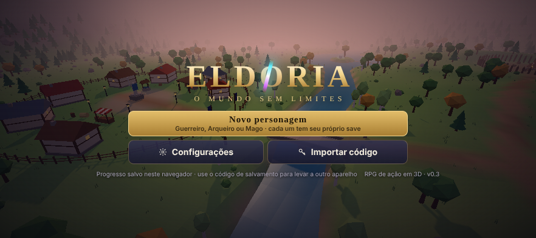
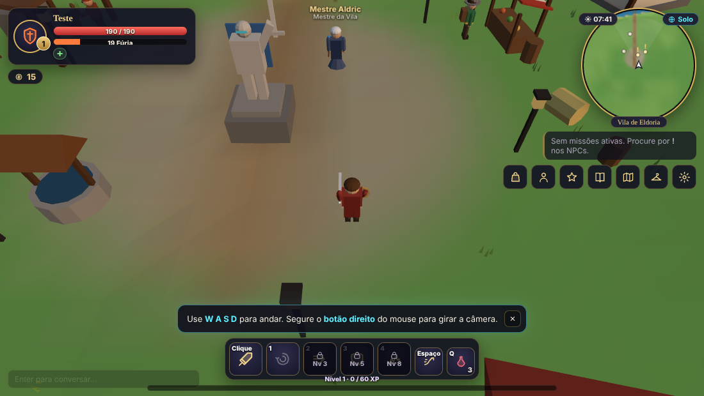
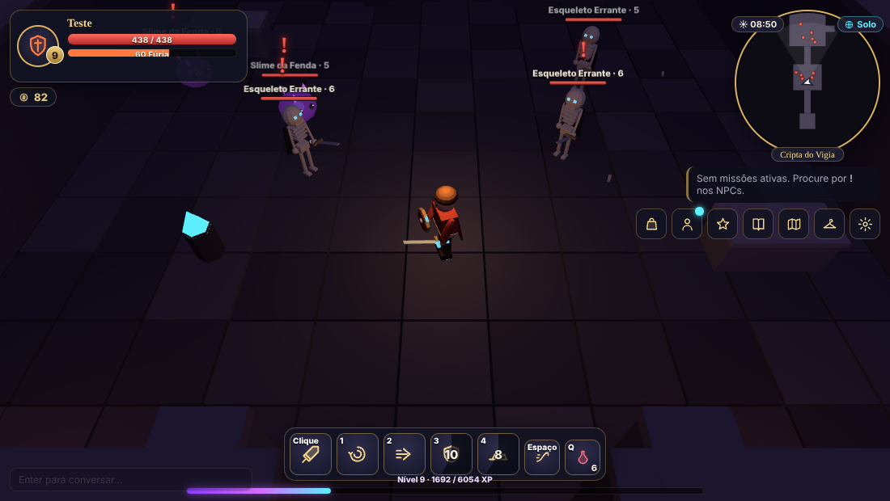
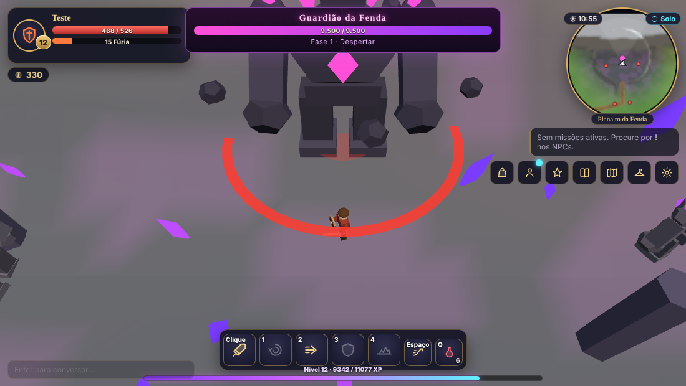
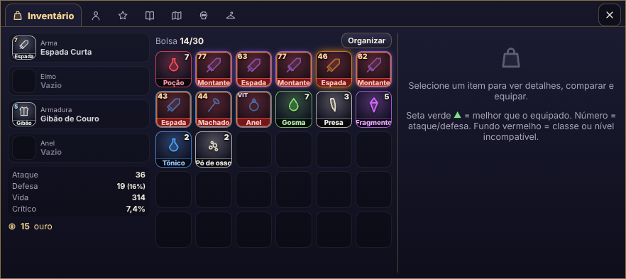
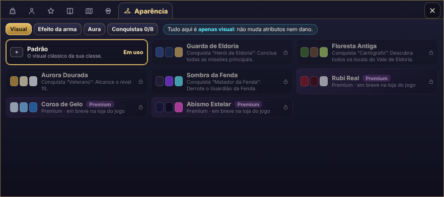
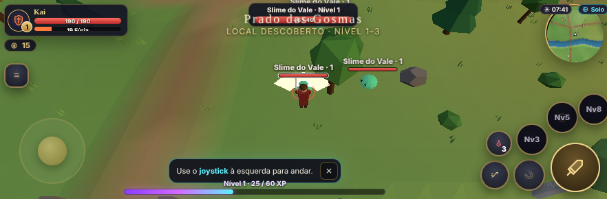
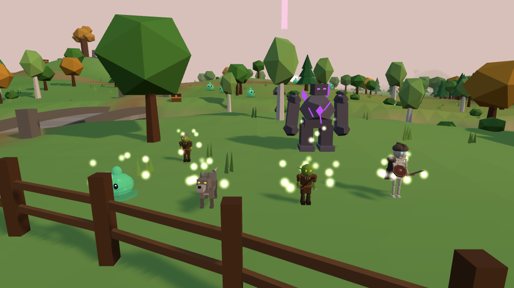
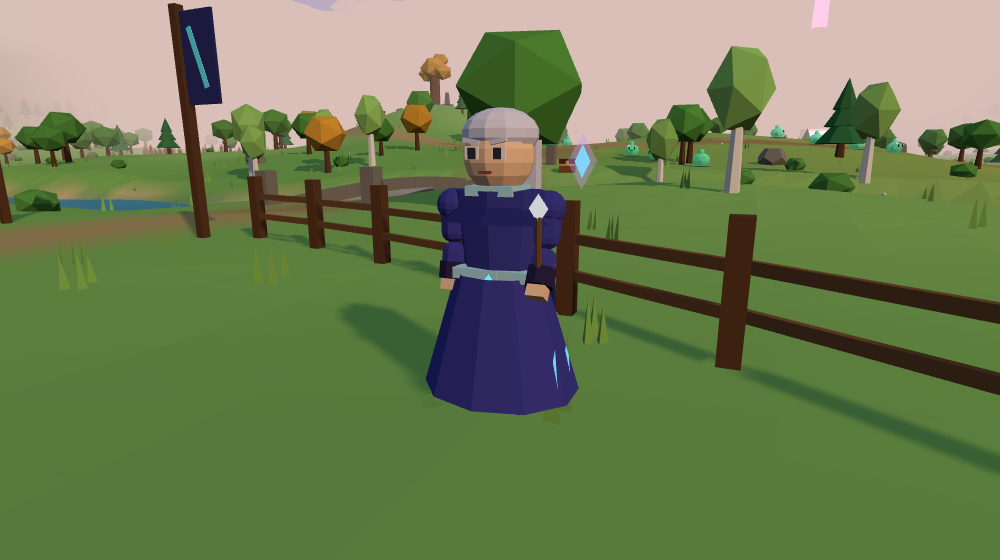

# ELDORIA: O Mundo Sem Limites

RPG de ação em 3D que roda no navegador (computador e celular), feito com **Three.js**.
Exploração do **Vale de Eldoria**, três classes jogáveis, combate em tempo real, saque com seis raridades,
missões, masmorra, chefe com fases, evento mundial, ciclo dia/noite, salvamento e multiplayer de presença.

> Todo o conteúdo (mapa, lore, nomes, criaturas, interface, modelos e código) é original.
> O jogo se chamava "RIFT" nas primeiras versões; desde a v0.3.2 o título é **ELDORIA** (nome do próprio mundo do jogo).
> O nome aparece em `src/index.html`, `src/main.js`, `src/ui/menus.js` e `docs/manifest.webmanifest`. Antes de publicar
> comercialmente, pesquise se o nome está livre na Play Store e no registro de marcas (INPI).
> Por compatibilidade, chaves internas (salvamento `rift.*`, códigos `RIFT1.`, `window.RIFT_STORE`) mantêm o nome antigo.



| Vila de Eldoria | Cripta do Vigia | Guardião da Fenda |
|---|---|---|
|  |  |  |
| **Inventário** | **Aparência (cosméticos)** | **Celular** |
|  |  |  |
| **Monstros** | **Mago** | |
|  |  | |

## Jogar agora

- **Abrir direto:** dê dois cliques em `dist/eldoria.html` (funciona offline; salva no navegador).
- **Versão instalável (PWA):** `docs/index.html` + `docs/manifest.webmanifest` — é a que vai para o GitHub Pages e para a Play Store.

### Controles

| Computador | Celular |
|---|---|
| **W A S D** mover · **clique** ataca na direção do cursor | **Joystick** à esquerda |
| **Botão direito** arrastado gira a câmera · **roda** aproxima | Arrastar no lado direito gira · **pinça** aproxima |
| **1–4** habilidades · **Espaço** esquiva · **Q** poção · **R** tônico | Botões **⚔**, **1–4**, esquiva e poção |
| **E** interagir · **I** inventário · **C** personagem · **K** habilidades · **J** missões · **M** mapa (ou clique no minimapa) | Botão **☰** abre os menus · toque no **minimapa** abre o mapa |
| **T** gestos · **P** modo foto · **Enter** bate-papo · **Esc** menu | Botão **Falar/Abrir** aparece perto de NPCs e baús |

Todas as teclas podem ser remapeadas em **Configurações → Controles**.

### Tela cheia

O jogo entra em **tela cheia sozinho no primeiro toque ou clique** — não há botão de entrar ou sair — e tenta travar em paisagem. Se o sistema sair da tela cheia (gesto de voltar, tecla Esc), ela volta no próximo toque. Limitações dos navegadores: nenhum site pode abrir em tela cheia sem um toque do usuário; o iPhone (Safari) não permite tela cheia para jogos web; e dentro de apps que bloqueiam o recurso o jogo continua na janela normal. Na versão instalada (PWA/Play Store), o `manifest` já abre em tela cheia e paisagem desde o início.

## O que existe nesta versão (v0.6)

- **Planície do Guardião:** o topo do planalto continua plano para o norte (~250 × 250 m, `PlainExt` em `src/engine/terrain.js`, `buildPlain` em `src/engine/world.js`), com 22 grupos de monstros, o trono do chefe no fundo e o portal para os Ermos atrás dele.
- **Três mapas:** o Vale de Eldoria (abaixo); os **Ermos da Fenda** (960 × 960 m, 8 regiões, níveis 10–20, pelo portal atrás do trono do Guardião); e os **Confins de Eldoria** (3,7 × 3,7 km, níveis 12–35, 7 biomas, portal no fim dos Ermos que exige nível 12). Os Confins são gerados por ruído e carregados em blocos de 120 m perto do jogador (`src/engine/confins.js`); os grupos de monstros nascem quando alguém chega perto e somem quando todos se afastam (`Spawners.updateConfins`).
- **Modo time:** convide jogadores online (toque em "no vale"); XP dividido igualmente entre quem lutou ou estava perto, e quem ajudou ganha o abate, as missões e as conquistas (inclusive chefes). Sem limite de membros. Código em `src/game/party.js`.
- **Mundo:** Vale de Eldoria com vila (7 casas, ferraria, mercado, estátua), rio com ponte de pedra, lago com ilha secreta e travessia por pedras, Floresta Sussurrante, Acampamento Goblin, Ruínas de Vel'Thar, Círculo de Pedras, Cripta do Vigia (masmorra) e o Planalto da Fenda com o portal. Dia/noite, tempestades localizadas, neblina de corrupção, sons ambientes e trilha generativa.
- **Classes:** Guerreiro (corpo a corpo, Fúria), Arqueiro (distância e mobilidade, Energia), Mago (controle de área, Mana). Cada uma com ataque básico próprio, esquiva própria e 4 habilidades liberadas nos níveis 1, 4, 7 e 10.
- **Dificuldade por nível:** cada nível que o inimigo tem acima de você aumenta o dano dele em 15% e reduz o seu em 12%. Regiões avisam quando são perigosas para o seu nível, e inimigos 4+ níveis acima aparecem com ☠. Não dá mais para farmar o Planalto no nível 4.
- **Progressão:** níveis até 30, curva de XP testada (nível 2 em ~1 minuto, nível 8 em ~25–30 minutos de jogo normal), 4 atributos sem redundância (Força, Agilidade, Inteligência, Vitalidade) + Defesa e Poder de Habilidade derivados, redistribuição de pontos.
- **Itens:** Comum, Incomum, Raro, Épico, Lendário e Mítico; afixos aleatórios; 8 itens nomeados únicos com efeitos (ex.: Espada do Primeiro Guardião, Arco da Névoa Azul, Cajado das Fendas, Anel da Aurora); proteção contra duplicatas; aprimoramento +1 a +5 sem chance de falha; loja.
- **Inimigos e IA:** Slime do Vale, Lobo Selvagem (matilha), Goblin Saqueador (foge com pouca vida), Goblin Atirador (mantém distância), Esqueleto Errante (patrulha), Guardião Corrompido (golpe com aviso no chão), Vigia Corrompido (mini-chefe), criaturas da Fenda e o raro Lobo Alfa noturno. Máquina de estados: inativo, patrulha, alerta, perseguição, ataque, atordoado, fuga, retorno ao posto, morte e reaparecimento.
- **Chefe:** Guardião da Fenda, 3 fases, golpe em arco, impacto em área, investida e chuva de fragmentos — todos os ataques fortes têm aviso visual — invoca adds e reaparece após 4 minutos. A primeira vitória garante o lendário da sua classe.
- **Missões:** 7 missões (abater, coletar, investigar, masmorra, chefe) com rastreador, marcadores **!** e **?** e objetivo no minimapa. A cadeia secreta das runas (Lua → Estrela → Sol) tem pistas no mundo.
- **Evento mundial:** "Ruptura da Fenda" (3 ondas com tempo limite e baú de recompensa). Roda **localmente** e é rotulado assim; a interface já aceita `source: 'server'`.
- **Transparência:** o Bestiário mostra as probabilidades reais de cada tabela de saque.
- **Salvamento:** até 8 personagens, cada um com seu próprio save; automático a cada 20 s e em eventos importantes; navegador (localStorage), nuvem por jogador quando aberto como página publicada no Claude, e **código de exportação/importação** para levar um personagem a outro aparelho.
- **Multiplayer com mundo compartilhado:** na página publicada, todos veem os mesmos monstros, eventos e horário (o primeiro jogador ativo simula o mundo; se sair, outro assume). Presença em tempo real, bate-papo e anúncios. XP e saque são individuais. Para um servidor dedicado no futuro, a mesma mensagem `mob` pode vir de um servidor em vez de um jogador.
- **Interface:** feita para caber na tela do celular deitado sem rolagem; HUD, minimapa (toque para abrir o mapa), mapa completo com eventos e chefe marcados, inventário com comparação, ficha, habilidades, diário de missões, bestiário, diálogo com NPCs, configurações (gráficos, áudio, controles, interface), controles de toque, modo foto, gestos.

## Estrutura

```
src/
  config/     valores editáveis: balance, classes, enemies, items, quests, world
  core/       lógica pura testável (XP, atributos, saque, inventário, missões, save)
  engine/     terreno, mundo, colisões, modelos, efeitos, céu, áudio
  game/       jogo: jogador, habilidades, combate, IA, chefe, eventos, rede, salvamento
  ui/         interface (HUD, painéis, diálogos, menus, toque) e style.css
vendor/three/ Three.js r187 (MIT) + utilitários
assets/modelos/  modelos .glb exportados (Blender)
docs/         versão PWA (GitHub Pages / Play Store), ícones e capturas
test/         testes unitários (node --test)
tools/        build, testes no navegador, exportação .glb, ícones
dist/eldoria.html  jogo completo em um único arquivo
```

Para mudar números de combate, XP, drops ou missões, edite `src/config/` — o código lê tudo de lá.

## Compilar e testar

Requer Node 18+.

```bash
npm install            # instala esbuild e playwright (devDependencies)
npx playwright install chromium   # só para os testes no navegador
npm run build          # gera dist/eldoria.html e docs/index.html
npm test               # 18 testes de lógica (XP, saque, itens de chefe, inventário, missões, save)
node test/balance-report.mjs   # tabela de duelos para conferir o equilíbrio
npm run e2e -- guerreiro   # joga automaticamente: missão, combate, masmorra, evento, chefe, morte, save
node tools/aimtest.mjs     # mira com analógico (Arqueiro/Mago) e golpe em morro
node tools/visual.mjs 882 393   # capturas dos modelos e de todos os painéis no celular deitado
node tools/wildtest.mjs    # portais e mapas novos (Ermos e Confins), monstros por bioma
node tools/fxshot.mjs      # capturas dos efeitos das habilidades
node tools/teamtest.mjs    # modo time com duas abas (convite, XP dividido, conquistas)
node tools/walkshot.mjs    # sequência lateral da caminhada e da corrida
npm run export-glb     # regenera assets/modelos/*.glb
```

## Blender

Em **Arquivo → Importar → glTF 2.0 (.glb/.gltf)**, abra qualquer arquivo de `assets/modelos/`:

- `personagens/` heróis das 3 classes · `inimigos/` todas as criaturas e o chefe · `npcs/` · `armas/` (versões comum e lendária) · `mundo/vale_de_eldoria.glb` e `mundo/cripta_do_vigia.glb`.
- Os personagens vêm articulados e com nomes em português (`quadril`, `torso`, `cabeca`, `braco_esq`, `perna_dir`, `mao_dir`…), prontos para receber um esqueleto (Armature) ou servir de referência para modelos novos.
- O mundo usa **cores por vértice**. Se aparecer branco, no Shader Editor ligue um nó **Color Attribute** ao **Base Color** do material.
- As animações do jogo são procedurais (`src/game/anim.js`). Para trocar um modelo provisório por um feito no Blender, exporte em .glb e substitua o construtor correspondente em `src/engine/models.js` usando o `GLTFLoader` do Three.js.

## GitHub

```bash
git init && git add . && git commit -m "ELDORIA v0.3.2"
git branch -M main
git remote add origin https://github.com/SEU_USUARIO/rift.git
git push -u origin main
```

Para jogar pelo navegador com link público: no GitHub, **Settings → Pages → Deploy from a branch → main / `docs`**. O jogo fica em `https://SEU_USUARIO.github.io/eldoria/`.

## Play Store (futuro)

O caminho mais curto é publicar a versão PWA (`docs/`) como app Android:

1. Hospede `docs/` em HTTPS (GitHub Pages serve).
2. **Opção A — Trusted Web Activity:** use o [Bubblewrap](https://github.com/GoogleChromeLabs/bubblewrap) (`npx @bubblewrap/cli init --manifest https://SEU_SITE/manifest.webmanifest`) para gerar o projeto Android e o `.aab`. Publique o arquivo `assetlinks.json` que ele indicar.
3. **Opção B — Capacitor:** crie um app Capacitor, copie o conteúdo de `docs/` para a pasta `www/` e gere o `.aab` no Android Studio (funciona totalmente offline).
4. Na Play Console: conta de desenvolvedor, ícones (`docs/icons/`), capturas, classificação etária e **política de privacidade**.

Observação: o salvamento em nuvem e o multiplayer atuais usam recursos da página publicada no Claude. Fora dela o jogo funciona sozinho, salvando no aparelho. Para multiplayer na Play Store será preciso um servidor próprio (ver abaixo).

## Economia entre jogadores

Na Vila de Eldoria, atrás da estátua, ficam duas barracas novas:

- **Banqueira Odete (Banco):** guardar e sacar ouro. O banco é da **conta**: vale para todos os seus personagens. Também faz **transferências**: você acha o jogador pelo nome ou pelo código, e o ouro sai do seu banco e cai no banco dele, mesmo que ele esteja offline.
- **Leiloeira Mara (Loja dos Jogadores):** você deixa um item com ela e escolhe o preço. Outros jogadores compram, e você recebe o ouro mesmo offline. A taxa é de 5%, cada um pode ter até 10 anúncios e cada anúncio dura 3 dias. Depois disso, o item volta pelo botão "Retirar". O Mercador Tomas continua abrindo o mesmo mercado.
- **Troca segura (Time → Trocar):** só com a pessoa a até 10 m.
  - Cada um monta a sua oferta (até 8 itens + ouro), e qualquer mudança desmarca o "Pronto" dos dois.
  - Depois vem uma tela de conferência ("você dá / você recebe").
  - A troca só acontece quando os dois confirmam exatamente as mesmas ofertas.
  - Itens de missão não podem ser trocados. Itens recebidos passam por um validador.

Onde cada coisa fica no banco de dados da página publicada:
- `data/users/<id>/rift_bank`: o banco, privado.
- `mail/<id>/in`: transferências chegando.
- `players/<id>`: diretório de nomes.
- `market`: anúncios da loja.

Limite importante: o jogo não tem servidor próprio, então tudo roda no aparelho de cada jogador. A troca protege contra golpes entre jogadores normais (trocar o item no último segundo, enganar na conferência), mas não contra alguém com o jogo modificado.

## Monetização (somente cosméticos) e Diamantes 💎

O jogo **não vende vantagem**: nada pago muda atributos, dano, drops ou progressão.

- **Diamantes:** moeda premium que **só entra comprando com dinheiro real**.
  - Não caem de monstros e não podem ser trocados, vendidos nem transferidos.
  - Servem só para os visuais premium: Rubi Real, Coroa de Gelo, Abismo Estelar, Jade Imperial, Dragão Carmesim, Geada, Ouro Celeste, Trovão, Pétalas e Vazio.
  - A loja abre em Aparência → "Loja de Diamantes" ou pela Banqueira Odete.
  - A compra com diamantes vale para a conta toda.
- **Segurança do saldo:** o saldo fica em `diamonds/<id>`, que pelas regras do banco de dados **só o dono do jogo pode escrever**. O jogador não consegue se dar diamantes. O que ele já comprou fica em `data/users/<id>/rift_dspend`.
- **Grátis por conquista:** 8 conquistas continuam liberando visuais sem pagar.
- Não há caixas de recompensa aleatórias pagas.

Tudo é configurado em `src/config/monetization.js` (`DIAMONDS`):

```js
packs: [{ id: 'd100', qty: 100, price: 'R$ 4,90' }, …], // pacotes mostrados
payment: 'off',            // 'off' (em breve) | 'link' | 'app'
paymentUrl: '',            // modo 'link': link de pagamento (pode usar {pack} e {code})
prices: { skin_rubi: 120, … } // preço de cada visual em diamantes
```

**Como receber pagamentos:**
- **Modo `'link'` (mais simples, para a versão web):**
  1. Coloque um link de pagamento seu (Mercado Pago, PagSeguro, Pix…).
  2. O jogador paga e manda o comprovante com o **código de jogador**, que aparece na loja.
  3. Você abre a Loja de Diamantes. Como dono, aparece o botão **"Painel do dono"**.
  4. Busque o jogador pelo nome ou código e credite os diamantes.
- **Modo `'app'` (Android na Play Store):**
  - Conteúdo digital dentro do app precisa usar a cobrança do Google.
  - O app expõe `window.RIFT_STORE.buyDiamonds(packId)`.
  - Um **servidor seu** valida o recibo e credita `diamonds/<id>`.

## Próximos passos sugeridos

- **Servidor multiplayer autoritativo** (Node + WebSocket): `src/game/net.js` já separa presença, mensagens e anúncios; o próximo passo é mover inimigos, saque e eventos para o servidor.
- Novas regiões atrás de outras fendas (o portal do Planalto é o gancho de história).
- Modelos e animações feitos no Blender no lugar das formas provisórias.
- Ferraria com encantamentos, mais missões secundárias, conquistas e ranking.

## Créditos e licenças

- Código, design, textos e modelos: originais deste projeto.
- [Three.js](https://threejs.org) r187 — licença MIT (`vendor/three/LICENSE`).
- Fontes Cinzel e Nunito Sans (Google Fonts, licença OFL), carregadas pela internet; sem conexão, o jogo usa fontes do sistema.
